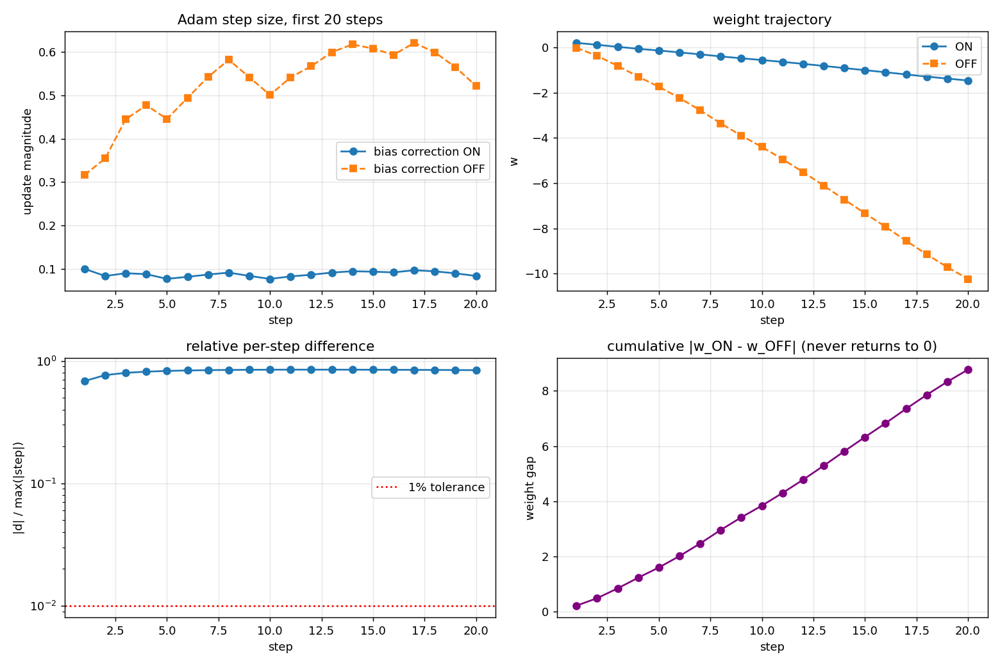
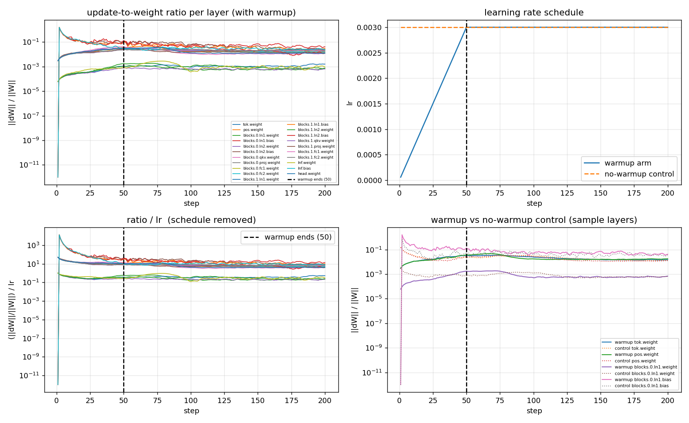
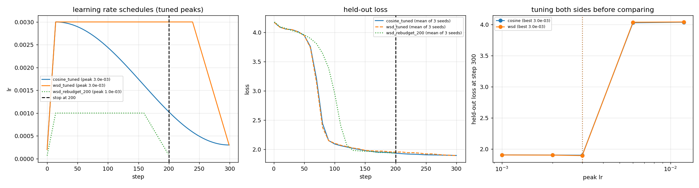
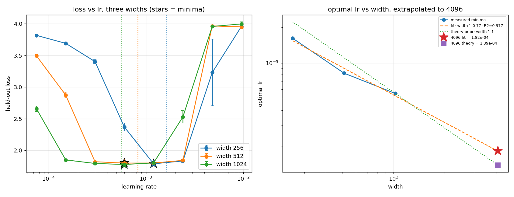

# ERA V5 — Session 11: Optimizers and Learning Rate Schedules

Reproducing Adam by hand, measuring what bias correction actually does, logging
update-to-weight ratios per layer, comparing cosine against WSD under an early
stop, and sweeping the learning rate across three widths to see whether the
optimum transfers.

Every number below is asserted against its generating artifact by
`tests/test_invariants.py`. If a number here drifts from the JSON it came from,
the test suite fails.

```
python3 src/task1_adam_by_hand.py
python3 src/task2_bias_correction.py
python3 src/task3_update_weight_ratio.py
python3 src/task4_cosine_vs_wsd.py
python3 src/task5_lr_width_sweep.py      # resumable; see note below
python3 tests/test_invariants.py
```

---

## Task 1 — Adam by hand, checked against PyTorch

One weight `w₀ = 0.3`, five gradients `[0.1, −0.2, 0.05, 0.4, −0.1]`,
`lr = 0.1`, `β₁ = 0.9`, `β₂ = 0.999`, `ε = 1e−8`. Computed in pure Python with
no torch and no numpy, then checked against `torch.optim.Adam` in float64 with
`weight_decay=0` (so this is Adam, not AdamW).

| t | g | m | v | m̂ | v̂ | step | w after |
|---|---|---|---|---|---|---|---|
| 1 | +0.10 | 0.010000000 | 0.000010000 | 0.100000000 | 0.010000000 | 0.099999990 | 0.200000010 |
| 2 | −0.20 | −0.011000000 | 0.000049990 | −0.057894737 | 0.025007504 | −0.036610350 | 0.236610360 |
| 3 | +0.05 | −0.004900000 | 0.000052440 | −0.018081181 | 0.017497495 | −0.013669065 | 0.250279426 |
| 4 | +0.40 | 0.035590000 | 0.000212388 | 0.103489386 | 0.053176604 | 0.044878207 | 0.205401219 |
| 5 | −0.10 | 0.022031000 | 0.000222175 | 0.053798442 | 0.044523995 | 0.025496033 | 0.179905186 |

**Result: agreement to 16 decimal places.** Worst absolute difference across
every field (`m`, `v`, `m̂`, `v̂`, step, weight) at every step is **5.55e−17**,
which is float64 rounding, not algorithm error. Final weight is
`0.179905186059460` from both the hand computation and PyTorch.

### The one detail that actually matters

PyTorch computes the denominator as

```
denom = sqrt(v_t) / sqrt(1 - β₂^t) + ε
```

which is `sqrt(v̂) + ε` — **ε sits outside the bias correction**. Writing
`sqrt(v̂ + ε)` instead is a different optimizer and disagrees in the low-order
digits. Getting 16-decimal agreement requires matching this placement. This is
the kind of thing that is invisible until you compare against a reference
implementation digit by digit.

A second sanity check worth noting: at `t = 1`, `m̂ = m/(1−β₁) = g` exactly. The
first bias-corrected step is a pure sign step of size `lr` (0.099999990, short
of 0.1 only by ε), regardless of gradient magnitude. That is the "every
parameter gets an update at its own scale" property from the session.

---

## Task 2 — Bias correction on versus off

Same weight, 20 steps, identical gradient sequence fed to both arms.

**The honest headline: at step 20 the difference has not stopped mattering.**
The relative per-step difference is still **84%**. The 20-step window the
assignment asks for sits entirely inside the phase where the gap is *widening*,
not closing.

Extending the same run to 6,000 steps locates the actual crossover:

| criterion | step after which it stops mattering |
|---|---|
| per-step relative difference < 5% | **2,327** |
| per-step relative difference < 1% | **3,916** |

Relative difference decays as 0.205 at step 1,000 → 0.070 at 2,000 → 0.009 at
4,000.

### Why, analytically

The two arms differ by an exact multiplicative factor on the step:

```
step_corrected = c_t · step_uncorrected,     c_t = √(1 − β₂^t) / (1 − β₁^t)
```

Solving `|c_t − 1| < 1%` directly gives **step 3,916** — matching the empirical
measurement exactly. That agreement between an independent closed-form
prediction and the measured run is the strongest check in this task.

Two consequences that are easy to get backwards:

- **The uncorrected step is *larger* early, not smaller.** `c₁ = 0.316`, so the
  bias-corrected step is 3.16× *smaller* at step 1. Without correction, `v` is
  initialised at zero and badly underestimates the second moment, so dividing
  by `√v` produces an overshoot.
- **The gap widens before it closes.** `c_t` is non-monotone: it bottoms out at
  **0.152 at step 12**, a worst-case overshoot factor of **6.57×**. The 20-step
  window lands in the middle of this.

### The timescale is set by β₂, not β₁

| β₂ | c₁ | corrected step is | crossover (1%) |
|---|---|---|---|
| 0.9 | 3.162 | larger | 38 |
| 0.95 | 2.236 | larger | 76 |
| 0.99 | 1.000 | larger | 390 |
| 0.999 | 0.316 | smaller | 3,916 |
| 0.9999 | 0.100 | smaller | 39,169 |

The crossover scales as `1/(1 − β₂)` — a clean factor of ~10 per decade. β₁
barely participates, because `(1 − β₁^t)` saturates within ~50 steps while
`(1 − β₂^t)` carries the 1,000-step tail.

There is an exact cancellation point: `c₁ = √(1−β₂)/(1−β₁)`, so `c₁ = 1` when
`β₂ = 1 − (1−β₁)² = 0.99` for `β₁ = 0.9`. At that β₂ the two bias corrections
cancel on step 1, and the **direction** of the effect flips either side of it.
This is visible in the table above.

### A second criterion, because the first one is easy to misread

The per-step difference converging does **not** mean the two runs converge. The
cumulative weight gap `|w_on − w_off|` reaches **8.77** and never returns to
zero — the early steps have already moved the weight somewhere else and nothing
later undoes it. Bias correction is not a transient you can skip because it
"washes out"; it permanently changes where you land.



---

## Task 3 — Update-to-weight ratio per layer

Ratio logged as `‖W_t − W_{t−1}‖₂ / ‖W_{t−1}‖₂`, measured from the actual weight
tensors either side of `opt.step()`, for all **21 parameter tensors** of a
2-layer decoder-only transformer (embeddings, per-block QKV / proj / MLP /
LayerNorms, final norm, LM head). Schedule is linear warmup over 50 steps then
constant, 200 steps total, AdamW at `lr_max = 3e−3`.

**Answer: warmup stops changing the ratio at step 50.**

The justification is structural rather than statistical. During warmup
`lr(t) = lr_max · t/50`, so the schedule is dragging the ratio upward by
construction. After step 50 the learning rate is *exactly* constant — asserted
in the test suite — so nothing the warmup schedule does can move the ratio
after that point. Any later change is the optimizer or the data, not warmup.

Two supporting measurements:

- **`ratio / lr` quotient**, which divides the schedule out. Structure visible
  in the raw ratio during the first 50 steps is almost entirely the ramp.
- **A no-warmup control arm** run at constant `lr_max` from step 1. After step
  50 both arms run at identical learning rate, so their ratios should agree.

The control converges later and noisily (per-layer: min 143, median 201). This
is expected and reported rather than smoothed over: by step 50 the two arms sit
at genuinely different points in weight space, so their ratios need not match
to tight tolerance even at identical lr. **The schedule argument is the clean
answer; the control is corroboration only.**

Layer-level observation: LayerNorm *biases* show ratios around 1e−1 while
LayerNorm *weights* sit near 5e−4, a ~300× spread within the same layer. Bias
vectors start at zero, so a relative-update metric is near-singular for them —
worth knowing before using this ratio as a health signal on a real run.



---

## Task 4 — Cosine versus WSD, both stopped at 200

Same model, 300-step budget, 3 seeds, held-out evaluation batches identical
across every arm. Both schedules share warmup (15 steps, 5%); WSD cools down
over its last 20%.

**Both sides tuned before comparing**, as the brief demands: a peak-lr sweep
over `[1e−3, 2e−3, 3e−3, 6e−3, 1.2e−2]` per schedule, each scored at its own
budget end. Selected peaks: cosine `3e−3`, WSD `3e−3`, re-budgeted WSD `1e−3`.
Both peaks are interior to the grid.

| arm | lr@200 | loss@200 | loss@300 |
|---|---|---|---|
| cosine (tuned, 3e−3) | 1.04e−03 | **1.9335** ± 0.0164 | 1.8940 |
| WSD (tuned, 3e−3) | 3.00e−03 | **1.9514** ± 0.0067 | 1.8913 |
| WSD re-budgeted for 200 (1e−3) | 1.00e−04 | 1.9352 ± 0.0251 | — |

Gap at 200: **+0.0179** (WSD worse), against seed noise of 0.0164 — readable,
but only just. Gap at 300: **−0.0027** (WSD better), which is *well inside*
noise and therefore **not a result**. Reported as a null rather than dressed up
as a WSD win.

Tuning turned out to be a near no-op here: `3e−3` was already optimal for both
schedules, so the tuned and matched-lr comparisons coincide. That is itself
worth recording — the tuning was run before the comparison was accepted, and it
happened to confirm the naive choice rather than overturn it.

### Which model would I keep?

**The cosine checkpoint, if 200 is a hard stop.** Not because cosine is the
better schedule, but because of the state each model is in at step 200:

- cosine has decayed to **35% of its peak lr**
- WSD is still at **100% of its peak** — sitting on its plateau, cooldown not
  started

A checkpoint taken mid-plateau is not a settled model. Its weights are still
oscillating in a high-lr basin, and that is exactly the nervousness the session
described about committing to WSD.

### But this is not a verdict on WSD

The step-200 comparison is **unfair to WSD by construction**. Both arms were
budgeted for 300 steps and only cosine's decay happens to overlap the stop
point. Stopping at 200 measures *which schedule is further through its decay*,
not which schedule is better — precisely the failure mode the brief warns
about.

The re-budgeted arm is the correct comparison for a 200-step budget: WSD that
knows its budget is 200 and finishes cooling down by then reaches **1.9352**
versus cosine's **1.9335** — a tie within noise. So at this scale, once both
sides are given a fair schedule for the budget they actually get, the two are
indistinguishable, and WSD's reputation rests on longer runs than anything
measured here.

What I would actually do: keep the cosine checkpoint now and keep the WSD run
alive, since its cooldown is the cheap part. If 20 more steps are affordable,
cool the WSD run down and re-compare.



---

## Task 5 — Learning rate sweep across widths

Widths 256 / 512 / 1024, eight learning rates spanning 7.5e−5 to 9.6e−3, two
seeds per cell, 80 steps, warmup plus cosine. Init is **std 0.02,
width-independent**, with a single global lr and no per-layer scaling — so
there is no muP-style correction holding the optimum in place, and the optimal
lr is free to move with width.

A naming caveat, because it changes which theory applies: in the muP
literature "standard parameterization" specifically means init std ∝ 1/√fan_in
with one global lr, and it is *that* setup for which the Adam result
α = −1 is quoted. A width-independent init std is **not** SP in that sense, so
α = −1 is not a prior this run inherits. It is included below as a reference
point only, not as a matching theory.

Held-out loss (mean of 2 seeds):

| lr | 256 | 512 | 1024 |
|---|---|---|---|
| 7.5e−5 | 3.8152 | 3.4929 | 2.6584 |
| 1.5e−4 | 3.6889 | 2.8736 | 1.8507 |
| 3.0e−4 | 3.4016 | 1.8217 | 1.7946 |
| 6.0e−4 | 2.3704 | **1.8003** | **1.7786** |
| 1.2e−3 | **1.7894** | 1.8013 | 1.8039 |
| 2.4e−3 | 1.8338 | 1.8432 | 2.5298 |
| 4.8e−3 | 3.2285 | 3.9641 | 3.9557 |
| 9.6e−3 | 3.9580 | 3.9486 | 3.9955 |

### The three minima

| width | grid argmin | sub-grid minimum (parabola in log-lr) | loss |
|---|---|---|---|
| 256 | 1.2e−3 | **1.62e−03** | 1.7894 |
| 512 | 6.0e−4 | **8.23e−04** | 1.8003 |
| 1024 | 6.0e−4 | **5.55e−04** | 1.7786 |

All three are interior to the grid, and every width shows a clean U — the loss
rises on both sides and blows up to the ln(64) = 4.16 ceiling above 4.8e−3. The
optimum moves left as width grows, which is what the experiment was built to
detect: without a width-correcting parameterization, lr does not transfer.

Fitting `η* = C · width^α` on the sub-grid minima:

**α = −0.771, R² = 0.977.** For reference, Adam under true SP (fan-in init) is
usually quoted at α = −1; this setup is not that, so the comparison is a sanity
check on magnitude and sign, not a prediction this run was expected to hit.

Two cautions on the fit itself. Three points fitting two parameters leaves one
residual degree of freedom, so R² = 0.977 is weaker evidence than it looks. And
an obvious hand-derivation for the exponent does **not** survive measurement:
if Adam moved each element by ~lr then ‖ΔW‖ would scale as lr·width, but
measured on this model ‖ΔW‖ goes roughly as lr·width^0.72 (Adam only takes a
full-size step where the gradient sign is consistent). So α here is an
empirical fit with no derivation behind it.

### Value I would use at width 4096

| method | value |
|---|---|
| fitted power law (α = −0.771) | 1.82e−04 |
| reference exponent (α = −1, anchored at width 1024) | 1.39e−04 |
| **recommended** | **1.39e-04** |

The two extrapolations differ by only 1.31×. That is reassuring about
*magnitude*, but the two are not independent evidence — the second is a
reference exponent imported from a different parameterization, not a
measurement of this one. I take the
**smaller** one: at width 4096 an lr that is too high risks a loss spike that
costs far more compute than the modest convergence speed given up by being
conservative. Asymmetric downside, so bias low.

### How confident am I? Low to moderate.

Supporting it: three widths with interior minima on a log grid, two seeds each,
a clean U-shape at every width, and a fitted exponent whose sign and rough
magnitude are unsurprising.

Limiting it, honestly:

- **Grid spacing is 2×**, so the minimum is only located to within a factor of
  ~2 before the parabola fit does the interpolation.
- **Only 80 steps per run.** Optimal lr for a short budget is higher than for a
  long run, so these minima are biased upward — and the bias need not be
  uniform across widths.
- **4096 is a 4× extrapolation** beyond the largest width measured, and that is
  exactly the regime where SP scaling tends to break down.
- **Two seeds cannot separate the curvature** of the loss-vs-lr curve from seed
  noise.
- **The exponent has no theory behind it.** The derivation that would predict
  −1/2 is falsified by the measured ‖ΔW‖ scaling above, and −1 belongs to a
  parameterization this model does not use. α = −0.771 is a fit to three
  points, nothing more.
- **Depth held at 2 layers.** Real 4096-width models are deep, and depth
  interacts with the optimal lr.
- **The 1024 basin is shallow and flat**: 1.7946 / 1.7786 / 1.8039 across three
  adjacent grid points. 512 and 1024 share the same grid argmin, so the sub-grid
  fit is doing real work in separating them, and α is sensitive to it.

What I would do instead of trusting this number: **not extrapolate.** Switch to
muP so the optimal lr transfers across width by construction, or spend one short
sweep at width 2048 to test the fitted exponent before committing anything at
4096.



---

## Bugs and corrections found while building this

Kept in the record rather than quietly fixed, per the practice from earlier
sessions.

**1. R² of −252 — a log/linear space mismatch.** The power-law fit built
predictions with `math.exp(logC + alpha*x)` (linear space) and compared them
against log-space targets:

```python
pred   = [math.exp(logC + alpha * a) for a in lw]   # linear
ss_res = sum((b - p)**2 for b, p in zip(le, pred))  # le is LOG
```

A negative R² of that magnitude is *impossible* for a least-squares fit, which
is what flagged it. The fitted `alpha` was always correct; only the reported
goodness-of-fit was garbage. Fixed to compare in log space: **R² = 0.977**.

**2. The synthetic task was calibrated twice, both times wrong first.** This
mattered more than the code bug, because a badly-scaled task silently
invalidates tasks 4 and 5 — if every lr and every schedule produce the same
loss, the comparisons are measuring nothing.

- v1: single-lag copy, no label noise. **Saturated** — loss reached 0.0013 and
  every schedule looked identical.
- v2: two-lag composition. **Too hard** — loss pinned at ln(64) = 4.16, no
  learning at all, equally uninformative. Measured: 4.05 versus 2.18 for
  single-lag at the same budget.
- v3 (final): single lag with 30% label noise, vocab 64. Floor
  ≈ 0.30 · ln(64) = 1.25, ceiling 4.16, runs land near 1.78–1.95. Learning, but
  nowhere near saturated.

**3. Earlier claim corrected: the bias-corrected step is *smaller* early, not
larger.** `c₁ = 0.316`. The uncorrected arm overshoots because `v` starts at
zero. The sign of this effect also flips depending on β₂ (see the β₂ table), so
"bias correction makes steps bigger" is simply wrong as a general statement.

**4. A plausible-sounding derivation for the width exponent, falsified by
measurement.** The argument: Adam moves each element by about `lr`, so
`‖ΔW‖ ≈ lr·width`, and holding the update-to-weight ratio fixed gives a clean
predicted exponent. Measuring the actual update norm on this model killed it —
`‖ΔW‖` scales as roughly `lr·width^0.72`, not `lr·width`, because Adam only
takes a full-size step on coordinates whose gradient sign is consistent, and
under batch noise the typical `m/√v` is well below 1. The derivation was
removed rather than kept as intuition, and α is reported as a bare empirical
fit. Recording it because it was convincing enough to nearly ship.

**5. Background jobs do not survive between sessions in this sandbox.** The
width-1024 sweep was killed twice mid-run before this was diagnosed. Fixed by
checkpointing every `(width, lr)` cell to
`artifacts/task5_partial.json` the moment it is measured, so the sweep resumes
instead of restarting. `src/sweep_chunk.py` drives it in chunks that fit inside
a single command. No cell was ever recomputed.

---

## Repository layout

```
src/
  model.py                      tiny decoder-only transformer + synthetic task
  task1_adam_by_hand.py         hand Adam vs torch.optim.Adam
  task2_bias_correction.py      bias correction on/off, 20 steps + extended
  task3_update_weight_ratio.py  per-layer update-to-weight ratio, warmup control
  task4_cosine_vs_wsd.py        tuned cosine vs WSD, early stop at 200
  task5_lr_width_sweep.py       lr x width sweep, minima, extrapolation
  sweep_chunk.py                resumable chunk driver for the width-1024 grid
artifacts/                      machine-generated JSON for every claim above
figures/                        plots for tasks 2-5
tests/test_invariants.py        asserts every README number against its artifact
```

## Limitations

- Model is 2 layers at width 128 for tasks 3 and 4, and up to width 1024 for
  task 5, on a single CPU core. Compute was deliberately spent on *many* runs
  (sweeps, controls, multiple seeds) rather than one large run, because every
  question in this assignment is a comparison.
- The data is synthetic, not natural language. Conclusions about schedule choice
  at this scale should not be read as claims about LLM pretraining.
- Task 4 uses 3 seeds and task 5 uses 2. Both are too few to resolve the small
  gaps that appear at step 300, which is why those are reported as nulls.
- The task-5 extrapolation to 4096 is not validated at 4096 or anywhere beyond
  1024.
